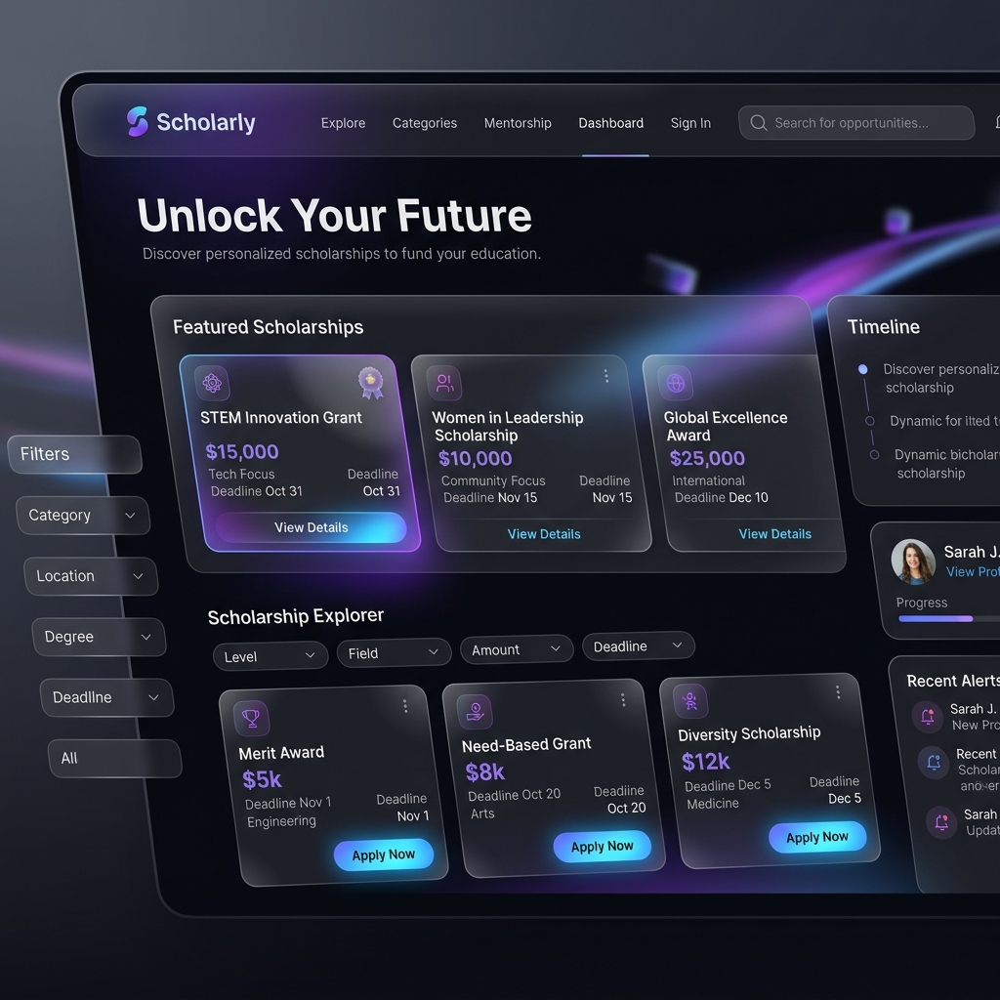

# 🌟 Gracy Christian – Portfolio Website

A modern, highly interactive, and visually stunning developer portfolio showcasing UI/UX design case studies, full-stack web applications, computer vision projects, and hackathon achievements.



---

## 🚀 Live Demo

- **Live Website**: [gracy-portfolio.vercel.app](https://gracy-portfolio.vercel.app)
- **GitHub Repository**: [Gracy1475/Gracy_Portfolio](https://github.com/Gracy1475/Gracy_Portfolio)

---

## ✨ Features & Highlights

- **🌌 Gravity Stars Background**: Custom interactive canvas particle system with gravity wells responding to real-time cursor movement.
- **🎨 Liquid Morphing Aesthetics**: Smooth scroll-triggered background morphing blobs built using **GSAP** and **ScrollTrigger**.
- **🎯 Custom Target Cursor**: Smooth spring-animated custom cursor with dynamic hover states on buttons and cards.
- **💎 Glassmorphic Design System**: Modern dark-mode aesthetic utilizing frosted glass effects, gradient typography, and glowing accents.
- **📱 Fully Responsive**: Tailored layout adaptation for mobile, tablet, and desktop screens.
- **📄 Direct Resume Integration**: One-click resume viewing and downloading options.

---

## 🛠️ Featured Projects

| Project | Description | Tech Stack | Links |
| :--- | :--- | :--- | :--- |
| **Udaan** | Scholarship Discovery & Application UI/UX Case Study | `Figma`, `User Research`, `UI/UX` | [Behance](https://www.behance.net/gallery/246844167/Udaan) |
| **FinShield** | Cybersecurity simulation platform for phishing attack awareness | `React.js`, `Node.js`, `MongoDB` | [GitHub](https://github.com/Gracy1475/Finshield) |
| **SmartShala** | Web-based school management system for academic & admin workflows | `React.js`, `Firebase` | [GitHub](https://github.com/Gracy1475/SmartShala-School-Management-System) |
| **FleetFlow** | Full-stack fleet management system tracking vehicles, drivers & trips | `Full-Stack`, `JavaScript` | [GitHub](https://github.com/Gracy1475/Odoo-GVP) |
| **Mind Sprint** | Real-time computer vision fitness app for pose estimation & posture analysis | `Python`, `OpenCV`, `MediaPipe` | [GitHub](https://github.com/Gracy1475/Mind-Sprint-Hackathon) |
| **StackIt** | Minimalist collaborative Q&A platform with rich text & voting | `JavaScript`, `Web Dev` | [GitHub](https://github.com/Gracy1475/Odoo-Hackathon-2025) |
| **EcoFinds** | Sustainable marketplace for pre-owned goods and circular economy | `React.js`, `Node.js` | [GitHub](https://github.com/Gracy1475/Odoo-X-NMIT-Hackathon-2025) |
| **Nexus** | Career networking platform for student-mentor connections | `Full-Stack`, `HTML/CSS` | [GitHub](https://github.com/Gracy1475/Nexus---Career-Networking-platform-) |
| **Memory Allocation Simulator** | OS memory management visualizer for First Fit, Best Fit & Worst Fit | `JavaScript`, `Algorithms` | [GitHub](https://github.com/Gracy1475/Memory-Allocation-Simulation-) |

---

## 🧰 Tech Stack

- **Frontend**: HTML5, CSS3 (Vanilla), JavaScript (ES6+)
- **Animations**: GSAP (GreenSock Animation Platform), ScrollTrigger, Canvas API
- **Design & Mockups**: Figma, Behance, AI UI Generator
- **Deployment**: Vercel

---

## 💻 Running Locally

1. **Clone the Repository**:
   ```bash
   git clone https://github.com/Gracy1475/Gracy_Portfolio.git
   cd Gracy_Portfolio
   ```

2. **Serve the Application**:
   You can serve the static files using any local server, e.g. with Python or Node:
   ```bash
   # Using Python
   python -m http.server 8000
   
   # Or using npx
   npx serve .
   ```

3. Open `http://localhost:8000` in your web browser.

---

## 📬 Contact & Profiles

- **GitHub**: [github.com/Gracy1475](https://github.com/Gracy1475)
- **LeetCode**: [leetcode.com/u/Gracy_Christian](https://leetcode.com/u/Gracy_Christian/)
- **Codeforces**: [codeforces.com/profile/Gracy1475](https://codeforces.com/profile/Gracy1475)
- **Codolio**: [codolio.com/profile/Gracy1475](https://codolio.com/profile/Gracy1475)

---

*Made with 💜 by Gracy Christian*
